# 🔬 TUMQuantum: Deep-Tech Research Whitepaper & Mathematical Architecture
## การวิจัยวิทยาการรหัสลับหลังยุคควอนตัมและสถาปัตยกรรมคณิตศาสตร์โครงตาข่าย (Lattice Mathematics)

**ผู้ประพันธ์:** Chief Quantum Scientist & Technical Architecture Board  
**วันที่ตีพิมพ์:** 1 พฤศจิกายน 2026  
**มาตรฐานอ้างอิง:** NIST FIPS 203, FIPS 204, FIPS 205, RFC 8446, RFC 3161, ISO/IEC 19790 (FIPS 140-3)

---

## 1. ภัยคุกคามจากคอมพิวเตอร์ควอนตัม (The Quantum Threat Vector)

คอมพิวเตอร์ควอนตัมที่ทรงประสิทธิภาพเชิงวิเคราะห์รหัสลับ (Cryptanalytically Relevant Quantum Computer - CRQC) คุกคามวิทยาการรหัสลับแบบกุญแจอสมมาตร (Asymmetric Cryptography) สองประการหลัก:

### 1.1 อัลกอริทึมของชอร์ (Shor's Algorithm - 1994)
แก้ปัญหาคณิตศาสตร์พื้นฐานในเวลาเชิงพหุนาม (Polynomial Time):
1. **ปัญหาการแยกตัวประกอบจำนวนเต็ม (Integer Factorization Problem - IFP):**
   $$\text{เวลาการคำนวณ:} \quad O\left((\log N)^3\right)$$
   ทำลายระบบ RSA-2048, RSA-3072, RSA-4096 ทั้งหมด
2. **ปัญหาลอการิทึมไม่ต่อเนื่อง (Discrete Logarithm Problem - DLP & ECDLP):**
   ทำลาย Diffie-Hellman, DSA, ECDSA (P-256, P-384, secp256k1), และ Ed25519 ทั้งหมด

**สูตรคำนวณจำนวน Logical Qubits ขั้นต่ำ:**
- สำหรับ RSA $n$-bit:
  $$Q_{\text{logical}} \approx 2n + 2$$
  (RSA-2048 ต้องการ $\approx 4,098$ logical qubits)
- สำหรับ ECC $n$-bit (บนฟิลด์ $\mathbb{F}_p$):
  $$Q_{\text{logical}} \approx 9 \lceil \log_2(p) \rceil$$
  (ECDSA P-256 ต้องการ $\approx 2,330$ logical qubits)

### 1.2 อัลกอริทึมของโกรเวอร์ (Grover's Algorithm - 1996)
เพิ่มความเร็วในการค้นหาในฐานข้อมูลที่ไม่ได้จัดเรียงแบบกำลังสอง (Quadratic Speedup):
$$\text{ความซับซ้อน:} \quad O\left(\sqrt{N}\right)$$
- ส่งผลให้คีย์สมมาตรขนาด $k$-bit มีความปลอดภัยเหลือเพียง $k/2$ บิต
- **แนวทางป้องกัน:** เพิ่มขนาดคีย์เป็น 256 บิต (เช่น AES-256, ChaCha20, SHA-384/SHA-512) ซึ่งให้ระดับความปลอดภัยอย่างน้อย 128 บิตหลังควอนตัม

---

## 2. ทฤษฎีคณิตศาสตร์แลตทิซ (Lattice-Based Cryptography)

TUMQuantum วางรากฐานอยู่บนปัญหาความยากของโครงตาข่ายมิติสูงในวงแหวนพหุนาม (Lattice Problems over Polynomial Rings):

### 2.1 วงแหวนผลหาร (Quotient Ring)
กำหนดวงแหวนพหุนาม $R_q = \mathbb{Z}_q[X]/(X^n + 1)$ โดยที่:
- $n = 256$ (มิติพหุนามคงที่)
- $q = 3329$ สำหรับ ML-KEM (Kyber)
- $q = 8380417$ สำหรับ ML-DSA (Dilithium)

### 2.2 ปัญหา Module Learning With Errors (M-LWE)
กำหนดเมทริกซ์สุ่ม $\mathbf{A} \in R_q^{k \times \ell}$ และเวกเตอร์ลับขนาดเล็ก $\mathbf{s} \in R_q^\ell$, เวกเตอร์สัญญาณรบกวน $\mathbf{e} \in R_q^k$:
$$\mathbf{b} = \mathbf{A}\mathbf{s} + \mathbf{e} \pmod q$$
- **ความยาก (Hardness):** ไม่มีอัลกอริทึมควอนตัมใดที่สามารถแยกความแตกต่างระหว่างคู่ $(\mathbf{A}, \mathbf{b})$ กับคู่สุ่มเอกรูป $(\mathbf{A}, \mathbf{u})$ ในเวลาพหุนามได้
- **ความปลอดภัย:** อ้างอิงตามความยากของการแก้ปัญหา Shortest Vector Problem (SVP) ในมิติ $d > 1000$

---

## 3. สถาปัตยกรรมการส่งมอบใน Sprints 1 – 15

```mermaid
graph TD
    subgraph Core Lab Engines
        T1["QuantumSafeTrustEngine<br/>(NIST FIPS 203/204)"]
        T2["HybridPermissiveMigrationAdapter<br/>(SCRUM-18)"]
        T3["PqcAssertionSigner<br/>(SCRUM-25 PQC-JWT)"]
        T4["HndlQuantumAttackSimulator<br/>(SCRUM-35)"]
        T5["PqcTls13HandshakeEngine<br/>(Sprint 10)"]
        T6["PqcZeroKnowledgeProver<br/>(Sprint 11 zk-SNARKs)"]
        T7["Pkcs11QuantumHsmDriver<br/>(Sprint 12)"]
        T8["Fips140AuditRunner<br/>(Sprint 13 FIPS 140-3)"]
        T9["TimeStampAuthorityEngine<br/>(Sprint 14 RFC 3161)"]
        T10["PqcOidcTokenEngine<br/>(Sprint 15 PQC-OIDC)"]
    end
    
    subgraph Interfaces & Standards
        I1["IQuantumSafeTrustEngine"]
        I2["IHybridMigrationAdapter"]
        I3["IPqcAssertionSigner"]
        I4["IHndlQuantumAttackSimulator"]
        I5["IPqcTls13HandshakeEngine"]
        I6["IPqcZeroKnowledgeProver"]
        I7["IPkcs11QuantumHsmDriver"]
        I8["IFips140AuditRunner"]
        I9["ITimeStampAuthorityEngine"]
        I10["IPqcOidcTokenEngine"]
    end

    T1 --> I1
    T2 --> I2
    T3 --> I3
    T4 --> I4
    T5 --> I5
    T6 --> I6
    T7 --> I7
    T8 --> I8
    T9 --> I9
    T10 --> I10
```

---

## 4. แผนงานวิจัยสู่อนาคต (Sprints 16 – 20 Roadmap)

1. **Sprint 16:** การปรับจูนความเร็วการคูณพหุนาม Number Theoretic Transform (NTT) ด้วยคำสั่ง AVX-512 และ ARM Neon
2. **Sprint 17:** สถาปัตยกรรม Composite X.509 Certificate Chain Validation ตามมาตรฐาน IETF LAMPS Draft
3. **Sprint 18:** โปรแกรม Quantum Readiness CLI Scanner ตรวจสอบความปลอดภัยระดับองค์กรแบบอัตโนมัติ
4. **Sprint 19:** อุโมงค์เครือข่ายเข้ารหัสควอนตัมเสถียรภาพสูง PQC-Encrypted Virtual Private Network Tunnel
5. **Sprint 20:** รวมแพ็กเกจส่งมอบ TUMQuantum Core Suite v2.0 เชิงพาณิชย์
